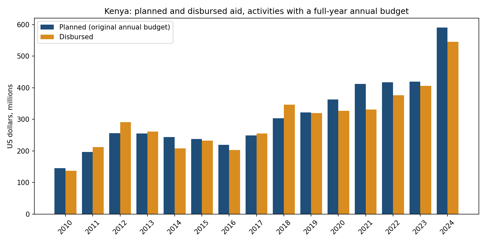
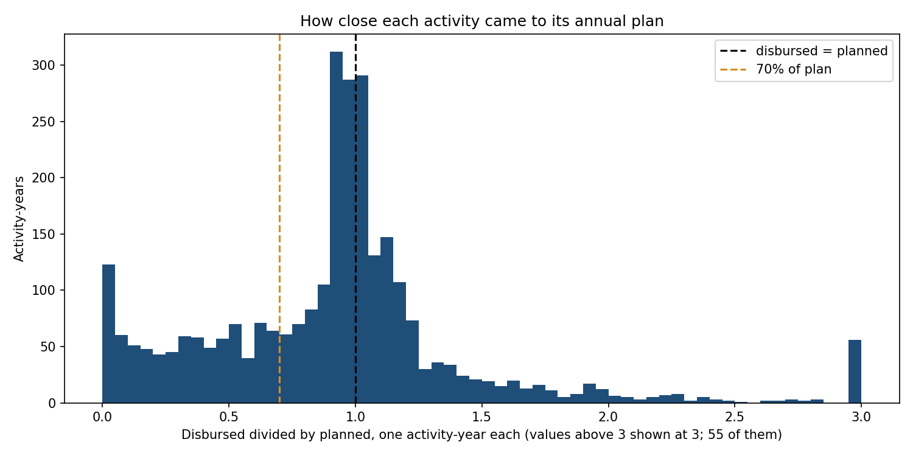

# Kenya Aid Flows

Downloads Kenya's open aid data, cleans it, and measures how much of the money donors scheduled for a year was disbursed in that year.



## What this project does

Donors tell Kenya how much they plan to give in a year, and governments and charities budget around those promises. When the money arrives late or short, projects stall. This project asks: for each project and year, how much of the scheduled money was disbursed in that year, and which donors and sectors fall short most?

The measure is a variant inspired by the Paris Declaration and [GPEDC indicator 5a](https://www.effectivecooperation.org/system/files/2021-02/Global%20Partnership%20Monitoring_Indicator%20Framework.pdf) (annual predictability: the share of aid disbursed within the fiscal year for which it was scheduled). It differs in four ways: it uses calendar years, not Kenya's July to June fiscal year; it works at activity level, not donor-country level; it includes NGO publishers; and an overshoot is not penalised in the main figure (a penalised variant is in the methodology file).

The data is the International Aid Transparency Initiative (IATI) records for Kenya, read through the d-portal query API: 26,438 activities, 469,065 transactions and 113,136 budget lines, snapshot taken 2026-10-19. Years compared: 2010 to 2024. DuckDB (a database in one file) holds the tables and plain numbered SQL files build the results.

## Results

Live results page: https://kenya-aid-flows.vercel.app (built by `site/build_page.py` from the same results files). The sensitivity versions, the publisher rules and the cleaning table are in [`docs/METHODOLOGY.md`](docs/METHODOLOGY.md).

The measure covers activity-years (one project in one calendar year) where the donor's original annual budget lines cover the whole year, the plan is above zero, and at least one disbursement is reported. Three publishers whose budgets cannot be compared with their spending (Gates Foundation, CGIAR, UNHCR) are set aside by stated rules. That leaves 2,901 activity-years from 1,416 activities.

- **73% of the scheduled money arrived in its own year.** Of $4.63 billion planned, $3.40 billion was disbursed up to the plan. Any amount above plan is not counted, so one over-spending project cannot hide another that fell short. A variant that also penalises overshoot (money that arrived divided by the larger of disbursed and planned) gives 60%.
- **Disbursed against planned: 0.96.** $4.45 billion was disbursed against $4.63 billion planned. The middle activity-year sent 0.95 of its plan.
- **28.9% of activity-years received under 70% of plan.** 58.8% fell short of plan (under 99%), 34.6% went over (above 101%), and 6.7% were within 1% of plan.
- **A simple rule picks out shortfalls about twice as well as chance.** The rule flags an activity-year when the same activity disbursed under 70% of plan in earlier years. Scored on 706 activity-years from 2020 on, of which 31% came in under 70% (the base rate, which is also the hit rate of flagging everything), its precision (the share of flags that were right) is 67% and its recall (the share of true cases caught) is 59%. Lift is precision divided by the base rate: 2.2, so its flags are right 2.2 times as often as flagging at random.
- **A logistic regression does not beat that rule.** A logistic regression is a standard classifier that weighs each input and gives the chance, from 0 to 1, that an activity-year falls short. Trained on 779 activity-years before 2020 and scored on the same 706 test rows, it ranks them a little better by PR-AUC (area under the precision-recall curve: how well the scores put true cases first; random order scores about the base rate, 0.31): 0.70 against 0.66 for the rule, which is ranked by its earlier-years ratio, lowest first. The gap is small. At the same number of flags (192) the model's precision is 65% against 67% and its recall 58% against 59%, so on the flags themselves it is no better.

**UNHCR is set aside, and it matters.** The UN refugee agency (UNHCR, XM-DAC-41121) publishes needs-based budgets, an appeal for what is needed, and reports most of its spending as expenditure, not disbursement. Its 8 activity-years carry $1.35 billion of planned money and only 20% of it arrived as disbursement. With UNHCR left in, the result is 61% arrived and a ratio of 0.79 on 2,909 activity-years. The rule that sets it aside was written after looking at UNHCR's numbers, so it is built to describe it.

By year (`outputs/results.json`, written by `report/make_results.py`). Arrived is the share of the plan that arrived in its year, and the sixth column puts UNHCR back, which is the dip in 2016 to 2020, 2023 and 2024:

| Year | Activity-years | Planned ($m) | Disbursed ($m) | Arrived | Arrived with UNHCR | Ratio | Median ratio | Under 70% of plan |
|---|---|---|---|---|---|---|---|---|
| 2010 | 90 | 145 | 137 | 68% | 68% | 0.94 | 1.05 | 15.6% |
| 2011 | 107 | 197 | 212 | 74% | 74% | 1.07 | 1.16 | 11.2% |
| 2012 | 169 | 256 | 291 | 78% | 78% | 1.14 | 1.03 | 13.0% |
| 2013 | 157 | 255 | 261 | 77% | 77% | 1.02 | 1.09 | 22.3% |
| 2014 | 141 | 244 | 208 | 66% | 66% | 0.85 | 1.00 | 25.5% |
| 2015 | 151 | 238 | 233 | 78% | 78% | 0.98 | 0.93 | 27.2% |
| 2016 | 181 | 219 | 203 | 68% | 43% | 0.93 | 0.92 | 34.8% |
| 2017 | 189 | 249 | 255 | 74% | 50% | 1.02 | 0.95 | 29.6% |
| 2018 | 225 | 304 | 347 | 71% | 51% | 1.14 | 0.96 | 32.9% |
| 2019 | 228 | 322 | 320 | 80% | 60% | 0.99 | 0.95 | 34.2% |
| 2020 | 240 | 363 | 327 | 75% | 58% | 0.90 | 0.93 | 35.0% |
| 2021 | 270 | 412 | 331 | 73% | 73% | 0.80 | 0.91 | 41.1% |
| 2022 | 200 | 417 | 376 | 68% | 68% | 0.90 | 0.88 | 32.5% |
| 2023 | 275 | 420 | 406 | 71% | 56% | 0.97 | 0.93 | 29.1% |
| 2024 | 278 | 591 | 545 | 77% | 63% | 0.92 | 0.93 | 24.1% |



The bunch near 1.0 is activities that sent about what they planned. The long tail to the left is the shortfall, and the pile at zero is activity-years with a plan and almost nothing disbursed.

### Which donors and sectors fall furthest short

Ranked by the share of the plan that arrived in its year, lowest first, among groups with at least 10 comparable activity-years (27 donors and 27 sectors qualify), because smaller groups swing on one or two projects. NGOs and agencies report too, so the first column is a reporting organisation.

| Reporting organisation | Activity-years | Planned ($m) | Arrived | Ratio |
|---|---|---|---|---|
| Diakonia | 11 | 1 | 1% | 0.01 |
| International Trade Centre (ITC) | 30 | 13 | 3% | 0.03 |
| Stichting Agriterra | 52 | 4 | 15% | 0.15 |
| International Organization for Migration (IOM) | 10 | 7 | 38% | 0.52 |
| HelpAge International | 28 | 20 | 44% | 0.44 |
| Global Environment Facility | 47 | 33 | 54% | 0.79 |
| Hivos | 17 | 38 | 55% | 0.57 |
| Mensen met een Missie | 11 | 6 | 57% | 0.62 |
| AFD | 38 | 55 | 60% | 0.75 |
| Liverpool School of Tropical Medicine | 11 | 2 | 66% | 0.71 |

| Sector group | Activity-years | Planned ($m) | Arrived | Ratio |
|---|---|---|---|---|
| Unknown | 16 | 27 | 13% | 0.14 |
| Unallocated or unspecified | 14 | 7 | 18% | 0.20 |
| Energy generation, renewable sources | 41 | 19 | 25% | 0.35 |
| Energy policy | 31 | 461 | 49% | 0.75 |
| Basic education | 75 | 75 | 50% | 0.60 |
| Post-secondary education | 84 | 65 | 55% | 0.79 |
| Industry | 41 | 25 | 59% | 0.73 |
| Health, general | 147 | 70 | 68% | 0.97 |
| Population and reproductive health | 101 | 101 | 68% | 0.92 |
| Other social infrastructure | 95 | 89 | 72% | 0.78 |

"Unknown" and "Unallocated or unspecified" are activities with no usable sector code. Several rows rest on little money, so read the planned column first. The Emergency response sector is no longer near the bottom (76% arrived on 73 activity-years); with UNHCR left in it is 24%.

## How I built it

1. **Download the data** (`ingest/fetch_dportal.py`). It pages through d-portal's `act` (activities), `trans` (transactions) and `budget` tables for Kenya, 5,000 rows per request, with a pause between pages, a User-Agent naming the project, retries with waiting, and a file cache so a re-run the same day does not download again. Every table matched the API's own row count. Raw files go to `data/raw/` (not committed).
2. **Look at the raw data** (`explore/first_look.py`). It prints transaction codes, flow types, budget types and missing values, then builds the simplest planned-vs-disbursed table with no cleaning. That table is unstable (0.20 to 4.93 depending on the year, 1.07 overall), which is what the later steps fix.
3. **Clean it, one rule per function** (`clean/`). Each rule logs rows in, rows out and dollars removed to `data/clean/rule_log.csv`. Incoming funds (the receiver's copy of money the donor already reported), non-aid flow types, impossible dates, exact duplicates, negative amounts and planned-disbursement rows are removed; the full table of rows and dollars removed per rule is in [`docs/METHODOLOGY.md`](docs/METHODOLOGY.md). Rows with a missing sector are kept as "Unknown". After cleaning there are 26,429 activities, 334,070 transactions and 79,571 budget lines.
4. **Load a database** (`warehouse/build_db.py`). The cleaned parquet files become three DuckDB tables.
5. **Build the models in SQL** (`sql/01_staging.sql` to `04_marts.sql`, run by `sql/run_sql.py`). The key table is `fact_activity_year`: one row per activity per year with the planned amount, the disbursed amount, their ratio and a coverage class. Of 46,232 activity-years, 25,460 have no original budget, 7,961 have annual lines covering only part of the year, 5,020 are covered only by a longer budget, and 7,791 have a full-year annual budget. Of those, 4,019 have a plan above zero and report a disbursement, and 2,901 remain after the publisher rules. Another 3,408 have a plan above zero but no disbursement row, and the other 364 have a plan of zero or less. Of the 3,408, 710 are counted as zero in the lower-bound version in the methodology file and 2,687 belong to activities that never report a disbursement. Those add to 3,397, not 3,408, because both counts leave out the set-aside publishers (the other 11). The rules:
   - Planned is the original budget only: a revised budget is a later plan and would hide slippage. Lines with no type count as original (see the methodology file).
   - Each budget line is cut into calendar-year pieces by days. A check confirms the pieces add back up to the lines. A year is comparable only if annual lines (400 days or fewer) cover every day of it; 3,634 lines run longer than a year.
   - Actual is the sum of disbursements (code D) dated in that year.
   - Years are 2010 to 2024, fixed in `clean/common.py` and `sql/01_staging.sql` so numbers do not change with the run date. Why 2025 is left out is under Problems I hit.
   - Each activity gets one sector group: the one with the most disbursed money, else the most planned money.
6. **Check the tables** (`checks/`, run by `checks/run_checks.py`). Ten SQL queries that must return zero rows, including that the day split keeps every budget dollar, that every comparable row has a full year of annual coverage (tested day by day from the budget table), that no disbursement is lost between the cleaned data and the fact table, and that two differently grouped marts agree. The script exits with an error if any returns a row.
7. **Try a rule of thumb** (`baseline/rule_of_thumb.py`). For each activity-year, add up the plans and disbursements of the same activity's earlier years. If that ratio is under 70%, flag it, then compare with what happened that year. The headline version scores only years with a disbursement. It excludes Gates by the copy rule on all years, and CGIAR and UNHCR using only years before 2020. A second version counts a missing disbursement as zero when the activity disbursed in an earlier year (nothing from later years decides who is in): precision 77% against a 46% base rate on 929 activity-years, but 132 of its 263 true positives are years with no disbursement row, so it partly detects activities that stop reporting.
8. **Fit a model** (`model/slippage.py`). A logistic regression (defined above) flags activity-years likely to arrive under 70% of plan. Same rows, same 2020 split and no peeking at later years as the rule. It is trained on years before 2020 only, with features from earlier years: the activity's earlier ratio and count of earlier years, plan size, the publisher's earlier record and the sector with the most planned money. The publisher's record keeps updating through the test years, from strictly earlier years only, like the activity's own earlier ratio: a 2022 row uses the outcomes of 2020 and 2021. At a fixed 0.5 cut-off it flags 134 rows with 75% precision and 47% recall. Nothing was tuned on the test years.
9. **Write the figures** (`report/make_results.py`, then `report/make_figures.py`) into `outputs/results.json` and `figures/`. The numbers in this README come from that file and the other two results files, `outputs/baseline_results.json` and `outputs/model_results.json`.
10. **Build the page** (`site/build_page.py`) writes the results page `site/index.html` from `outputs/results.json` and `outputs/model_results.json`.
11. **Test the rules** (`tests/`). Small hand-made tables test every cleaning rule, the history features, the year settings in SQL and Python are tested to agree, and a tiny DuckDB tests that `run_checks.py` reports a failing check and exits non-zero.

## Problems I hit

- **Multi-year budgets made the ratio meaningless.** Split evenly, a three-year budget is not the plan for any one of its years. The sensitivity run on those years alone gives a ratio of 2.90 against 0.96 for the headline. Only years fully covered by annual lines are compared.
- **Three publishers' budgets did not describe their spending.** Gates copied its disbursements into its budget (100% of its 1,090 activity-years within 1% of plan), CGIAR budgeted only a slice (median ratio 4.47), and UNHCR budgeted needs (20% arrived). The per-publisher figures are in `outputs/results.json` and each has a stated rule in the methodology file. IFC had the same kind of problem: its disbursements are flow type 35 (private market investment), not aid, and the cleaning log shows 129 rows worth $3,842 million, so keeping only flow type 10 (and blank) removed them.
- **The newest year looked like a collapse.** Disbursements dated 2025 are 25% below 2024 while the 2025 budgets are the largest of any year. I treated that as late reporting and ended the window at 2024.
- **A row counter is not a duplicate test.** In the transactions table `trans_id` is only a row counter inside each activity (`clean/clean_transactions.py`), so it cannot identify a repeated row and is left out of the duplicate key. The sector stays in the key, because one disbursement split over two sectors is two real rows and dropping the sector would delete one of them. The key is the activity, reference, date, code, flow type, currency, amount and sector.
- **The budget table holds two kinds of rows.** d-portal mixes budgets and planned disbursements in one table. The rule log shows 24,209 planned-disbursement rows, so they are removed before anything is summed.

## Data

IATI data for Kenya through the d-portal query API (`https://d-portal.org/q.json`), retrieved 2026-10-19 (the snapshot date: a re-run reuses the most recent download and keeps this date unless run with `--refresh`). Each publisher sets its own licence in the IATI Registry. The raw data is not redistributed here, and derived figures credit "IATI publishers via d-portal.org", retrieved 2026-10-19. Amounts are in US dollars as converted by d-portal.

## Limits

- Only 2,901 of 46,232 activity-years can be compared, and publishers that give full-year budgets are not a random sample of aid to Kenya.
- The comparison is against the original budget. Budgets are often revised, so a project can look short when its plan changed.
- Removing incoming funds does not remove every double count: if a donor and its implementer both report one disbursement, both stay.
- Negative commitments and disbursements (reversals) are dropped, not netted: 18,815 rows summing to -$3,691 million across the whole cleaned transaction table, and 1,386 negative budget rows summing to -$294 million. I did not measure the effect on the headline figures.
- Overlapping original budget lines are added together. Inside the headline set that is $10 million of $4.63 billion planned (0.2%), so I left it in.
- The publisher thresholds were chosen after seeing the data, and other unusual publishers may remain.
- A zero disbursement can be a reporting habit (spending reported as expenditure). The expenditure version counts D plus E, which double counts a publisher that reports the same money both ways.
- Sector names come from a list I typed from the OECD DAC codes. I have not compared the yearly totals with published Kenya aid figures.
- The baseline is scored on 706 activity-years, and 557 test-year rows had no earlier year to learn from.

## How to run

Prerequisites: Python 3.13 with the packages in `requirements.txt` (DuckDB, pandas, pyarrow, requests, matplotlib, scikit-learn, numpy, pytest).

```
python -m pip install -r requirements.txt
python run_all.py            # all stages; the first download takes about 14 minutes
python -m pytest             # the tests
```

Each stage also runs alone, for example `python checks/run_checks.py`. `python run_all.py --refresh` downloads again.

`.github/workflows/refresh.yml` runs on the 3rd of each month at 05:00 UTC, and on demand from the Actions tab. It downloads fresh data, runs every stage with `--refresh`, runs the tests and keeps `outputs/*.json` as a downloadable artifact. It does not deploy the results page. Its first scheduled run has not happened yet.

## Project structure

```
ingest/     download with retries and a cache      explore/   raw-data facts, first naive table
clean/      one function per cleaning rule         warehouse/ parquet files into DuckDB
sql/        staging, fact, dimensions, marts       checks/    SQL queries that must return zero rows
baseline/   the 70% rule and its scores            report/    results.json and the charts
model/      logistic regression vs the rule         site/      results page and its builder
outputs/    results.json and its inputs            figures/   the two charts
tests/      pytest                                 run_all.py every stage in order
```

## License

MIT. See `LICENSE`.

Alven Yuka · [LinkedIn](https://www.linkedin.com/in/alven-yuka-610b78174/) · [Email](mailto:alvenyuka2@gmail.com)
